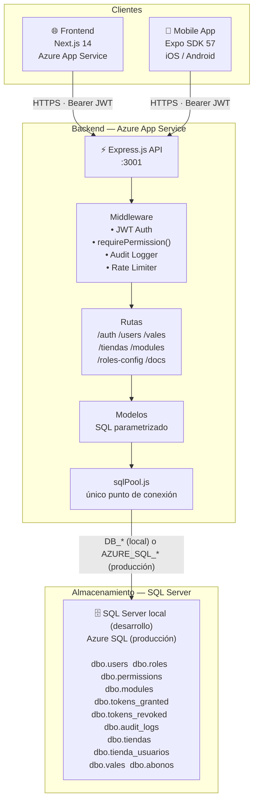
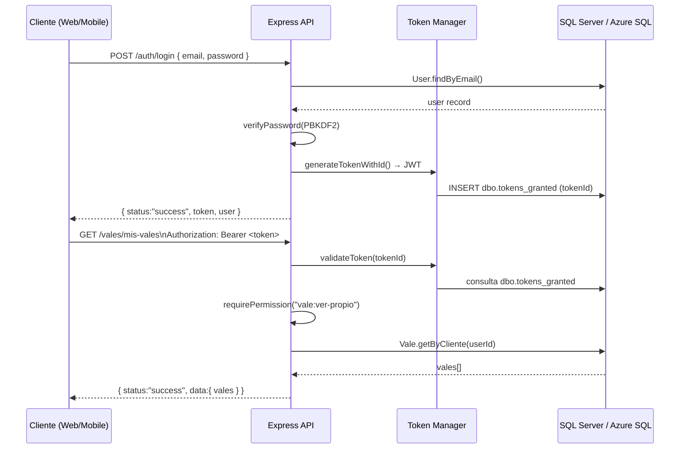
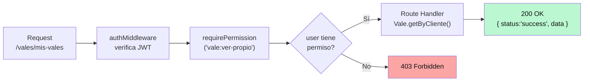

# Arquitectura del Sistema — Mi Valecito

## Diagrama General

El almacenamiento es el mismo esquema en los dos ambientes; solo cambia la forma de conexión,
que se valida al arrancar (una sola forma presente). Las fotos van a la carpeta local
`datos/uploads/` o a Azure Blob Storage si está configurado.

## Flujo de Autenticación

## Flujo de Permisos

## Stack por Capa

| Capa | Tecnología | Notas |
|------|-----------|-------|
| Mobile | Expo SDK 57 + React Native | Zustand + SecureStore |
| Frontend | Next.js 14 App Router | SCSS + React Bootstrap |
| API | Express.js + Node.js | SQL en los modelos, vía `sqlPool.js` |
| Auth | JWT + PBKDF2 | 24h / 7d (rememberMe) |
| DB dev | SQL Server local (Developer o Express) | Base `MiValecito_Dev`; se prepara con `npm run db:setup` |
| DB prod | Azure SQL | Mismo esquema: `database/scripts_sql/` |
| Hosting | Azure App Service | Brazil South |
